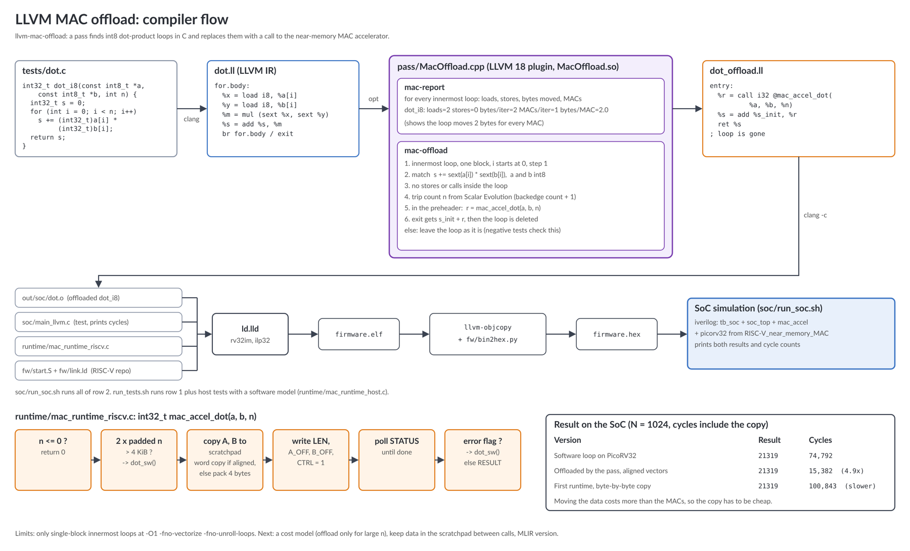

# llvm-mac-offload

An LLVM pass that finds int8 dot-product loops in C and replaces them with a
call to my near-memory MAC accelerator. This is the compiler part of my
[RISC-V_near_memory_MAC](https://github.com/madihaanjumshahzad-creator/RISC-V_near_memory_MAC) project
(PicoRV32 RISC-V core + int8 MAC accelerator with a 4 KiB scratchpad).

The C code is normal C:

```c
int32_t dot_i8(const int8_t *a, const int8_t *b, int n)
{
    int32_t s = 0;
    for (int i = 0; i < n; i++)
        s += (int32_t)a[i] * (int32_t)b[i];
    return s;
}
```

After the pass the loop is removed and the function calls
`mac_accel_dot(a, b, n)`. The runtime copies both vectors into the
scratchpad, starts the accelerator, waits and returns the result.



## Files

| Path | What it is |
| --- | --- |
| `pass/MacOffload.cpp` | pass plugin for LLVM 18 (new pass manager), two passes |
| `tests/dot.c` | the int8 dot product that should be offloaded |
| `tests/negative.c` | loops that must not be offloaded (int16, store in loop, shifted index) |
| `tests/main.c` | host test, offloaded result vs plain C for 10 lengths |
| `runtime/mac_runtime_host.c` | software model of the accelerator for the host test |
| `runtime/mac_runtime_riscv.c` | driver for the real accelerator, falls back to software if needed |
| `soc/` | builds the firmware with clang + the pass and runs it on the SoC in Icarus Verilog |

The two passes:

- `mac-report` prints loads, stores, bytes moved and MACs per iteration for
  each innermost loop, and bytes moved per MAC.
- `mac-offload` looks for `acc += sext(a[i]) * sext(b[i])` with int8 `a` and
  `b` that do not change in the loop, `i` from 0 with step 1, and no stores or
  calls in the loop. It gets the trip count from Scalar Evolution, puts
  `acc_init + mac_accel_dot(a, b, n)` in the preheader, sends the result to
  the loop exit and deletes the loop.

## How to run

You need clang/LLVM 18 with the dev files, CMake, and Icarus Verilog for the
SoC run. On Ubuntu 24.04 (I used WSL on Windows):

```sh
sudo apt install clang-18 llvm-18-dev lld-18 cmake iverilog
sh run_tests.sh                                   # pass + host tests
sh soc/run_soc.sh ../RISC-V_near_memory_MAC       # full system on the RISC-V SoC
```

## Results

Host tests (`run_tests.sh`):

```
mac-report: dot_i8, loop at for.body: loads=2 stores=0 bytes/iter=2 MACs/iter=1 bytes/MAC=2.0
mac-offload: dot_i8: int8 dot-product loop at for.body replaced by mac_accel_dot
negative tests: no loop offloaded
n=0 ... n=2048 and n=-5: offloaded result = reference, mac_accel_dot called 8 times (expected 8)
RISC-V assembly (rv32im) calls mac_accel_dot
```

On the SoC, N = 1024, cycles include copying the data into the scratchpad:

| Version | Result | Cycles |
| --- | --- | --- |
| Software loop on the core | 21319 | 74,792 |
| Offloaded by the pass, aligned vectors | 21319 | 15,382 (about 4.9x) |
| Offloaded, first runtime with byte-by-byte copy | 21319 | 100,843 (slower than software) |

My first runtime copied the data into the scratchpad one byte at a time, and
then the offloaded version was slower than plain software. After I changed it
to copy whole words for aligned data, it was about 4.9x faster. So the cost of
moving the data matters as much as the computation.

## Limits / to do

- Only single-block innermost loops at `-O1 -fno-vectorize -fno-unroll-loops`.
  Unrolled or vectorized loops are not matched yet.
- `a` and `b` must not change inside the loop (no stores in the loop).
- To do: a cost model (offload only when n is big enough to pay for the
  copy), keep data in the scratchpad between calls, and try the same in MLIR.

## License

MIT, see `LICENSE`. PicoRV32 and the SoC are in the RISC-V_near_memory_MAC repo.
